<p align="center">
  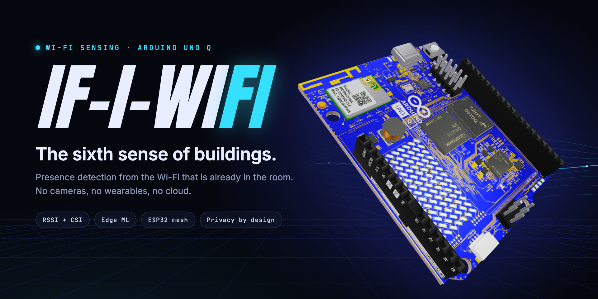
</p>

<p align="center">
  <b>Presence sensing from the Wi-Fi that is already in the room.</b><br>
  No cameras. No wearables. No cloud.
</p>

<p align="center">
  
  
  
  
  
  
</p>

<p align="center">
  <a href="https://vincenzoparente04.github.io/if-i-wi-fi/"><b>▶ Live demo</b></a> ·
  <a href="#-quick-start">Quick start</a> ·
  <a href="docs/HOW_IT_WORKS.md">How it works</a> ·
  <a href="docs/VISION.md">Vision</a> ·
  <a href="docs/JOURNEY.md">Journey</a>
</p>

<p align="center">
  <a href="https://vincenzoparente04.github.io/if-i-wi-fi/">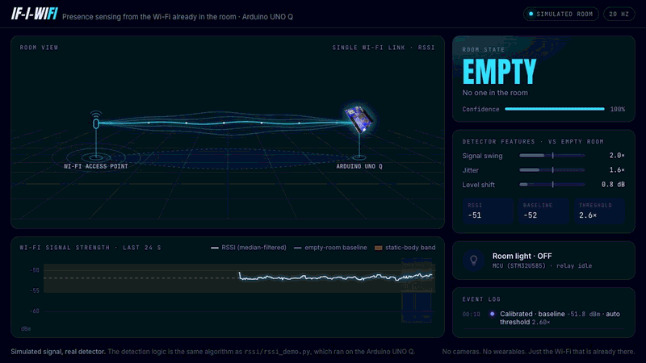</a>
  <br><sub>The web demo: a simulated room running the real detector. Someone walks in, sits down and leaves, and the Wi-Fi link notices every step.</sub>
</p>

---

##  Why this exists

Buildings are **over-sensored and under-aware**. We fill them with cameras,
motion sensors and smart devices, yet most rooms still cannot answer a simple
question: *is anyone here right now?*

- **Cameras** answer it, but nobody wants one in a bedroom, a bathroom or a care home.
- **PIR motion sensors** are private, but forget you the moment you sit still.
- **Wearables** only work if people remember to wear them, and the people who
  need them most are the least likely to.

Meanwhile every room is already full of radio waves. Wi-Fi bounces off walls,
furniture and **people**, and a human body changes that signal in ways we can
measure. **If-I-Wi-Fi turns the Wi-Fi a building already has into a
privacy-preserving sense of presence**, running on a €100-class board at the edge.

> *The infrastructure is already in the room. We are just the first ones to listen.*

## Wi-Fi sensing vs. the usual suspects

| | 📷 Camera | 🚶 PIR sensor | ⌚ Wearable | 📡 **If-I-Wi-Fi** |
| --- | :---: | :---: | :---: | :---: |
| Notices someone sitting still | ✅ | ❌ | ✅ | ✅ near the link |
| Works in the dark | ⚠️ needs IR | ✅ | ✅ | ✅ |
| Needs people to cooperate | no | no | **yes** | no |
| Captures images or identity | **yes** | no | **yes** | no |
| Acceptable in bathrooms and bedrooms | ❌ | ✅ | ✅ | ✅ |
| New hardware | one per room | one per room | one per person | the existing AP + one board |
| Knows *where* you are | precise | zone | with infrastructure | coarse, with an ESP32 mesh |

##  How it works

<p align="center">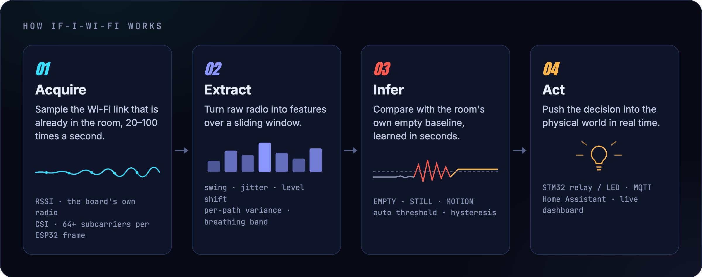</p>

1. **Acquire.** Sample the Wi-Fi link 20–100 times a second: the signal
   strength (RSSI) seen by the UNO Q's own radio, or the full channel (CSI)
   seen by ESP32 nodes.
2. **Extract.** Turn raw radio into features: how much the signal swings, how
   noisy it is, how far its level has moved from the empty room.
3. **Infer.** Compare with the room's own baseline, learned in seconds, using
   an automatic threshold and hysteresis. Output: **EMPTY**, **STILL** or **MOTION**.
4. **Act.** The Linux side of the UNO Q tells its microcontroller to switch a
   relay or a light, in real time.

The full algorithm, the physics and the honest limits are in
[docs/HOW_IT_WORKS.md](docs/HOW_IT_WORKS.md).

##  Architecture

<p align="center">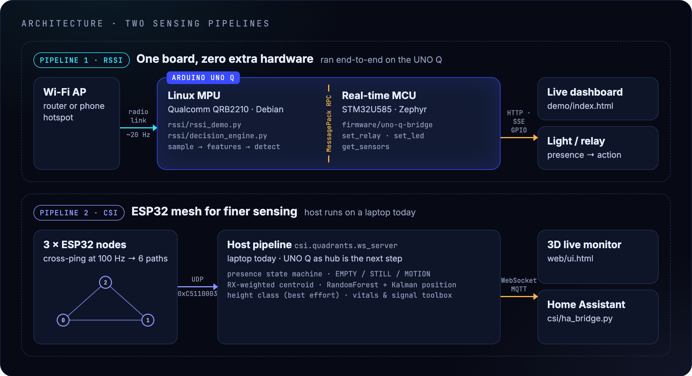</p>

**Pipeline 1: RSSI, one board.** The [Arduino UNO Q](docs/HARDWARE.md) has two
brains: a Qualcomm Linux processor runs the Python detector, and an STM32
microcontroller drives the physical world. They talk through `arduino-router`
(MessagePack RPC). No extra hardware: the sensor is the board's own Wi-Fi
radio. → [`rssi/`](rssi), [`firmware/uno-q-bridge`](firmware/uno-q-bridge)

**Pipeline 2: CSI, an ESP32 mesh.** Three ESP32 ping each other 100 times a
second and report the full channel of six radio paths crossing the room. A
host pipeline turns that into presence, 2D position and experimental vital
signs, streamed to a 3D web monitor. → [`csi/`](csi), [`firmware/esp32-radar3d`](firmware/esp32-radar3d), [`web/`](web)

##  Demo

| RSSI dashboard ([`demo/`](demo)) | CSI 3D monitor ([`web/`](web)) |
| :---: | :---: |
| 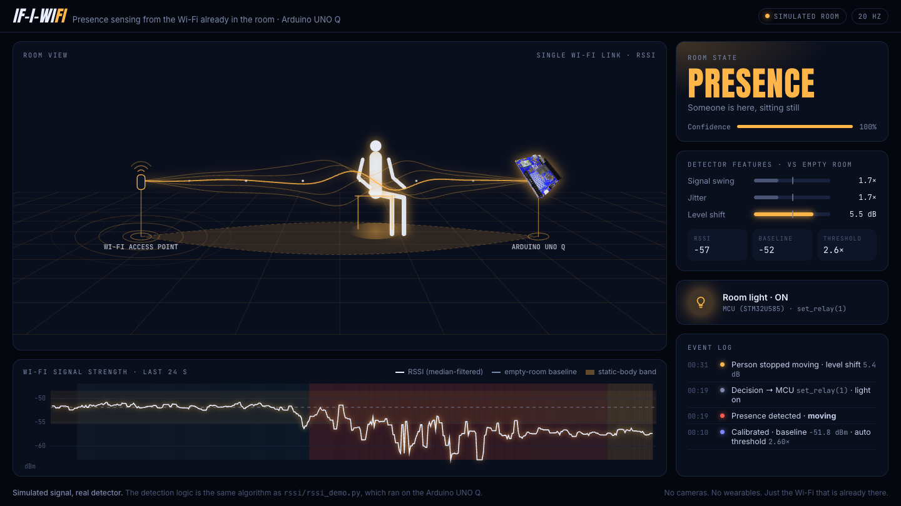 | 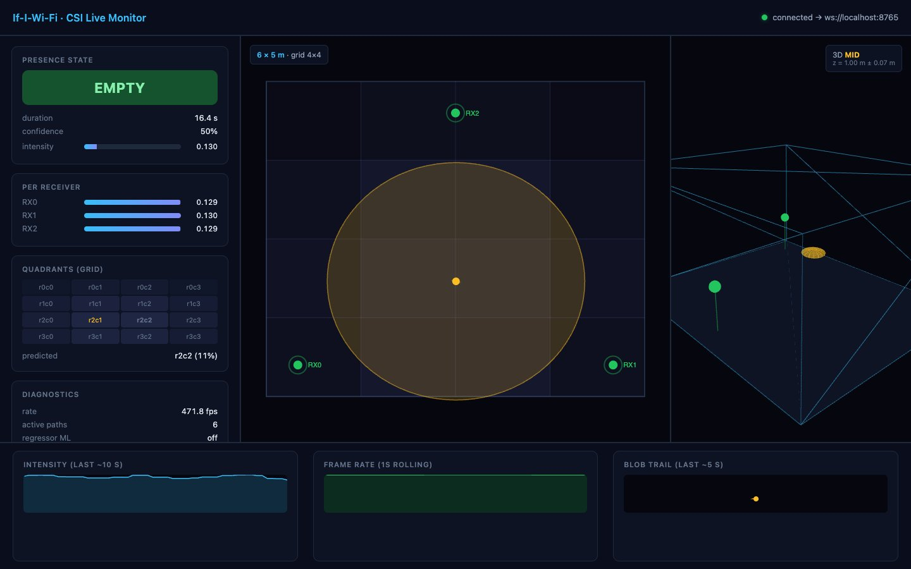 |
| Simulated room, real detector. Also runs **live** on the UNO Q or on your laptop's Wi-Fi. | Presence, grid heatmap, position and 3D blob from the ESP32 mesh (shown with simulated frames). |

We no longer have the UNO Q we built this on (it was on loan for the
hackathon), so the demo is designed to run without it. The detector is the
one we used on stage; only the room is simulated.

##  Quick start

```bash
git clone https://github.com/vincenzoparente04/if-i-wi-fi.git && cd if-i-wi-fi

# 1. The web demo: nothing to install
python3 -m http.server 8000        # then open http://localhost:8000/demo/

# 2. The real detector on a real Wi-Fi link: your Mac's (or --source sim anywhere)
python3 -m rssi.rssi_demo --source macos    # then open http://localhost:8080/

# 3. The CSI pipeline end to end, with three simulated ESP32
python3 -m venv .venv && source .venv/bin/activate
pip install -e ".[dev]"
./tools/simulate_csi.sh
pytest                              # 123 tests
```

Have the hardware? Start from [`rssi/README.md`](rssi/README.md) for the UNO Q
and [`firmware/esp32-radar3d`](firmware/esp32-radar3d) for the ESP32 mesh.

##  Where it matters

<table>
  <tr>
    <td width="33%" valign="top">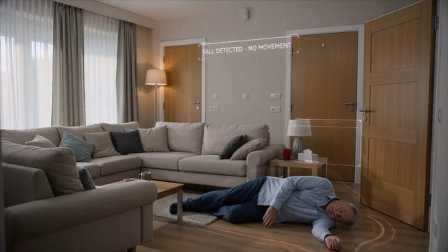<br><b>Assisted living</b><br><sub>Notice a fall or unusual stillness without a camera in the room.</sub></td>
    <td width="33%" valign="top">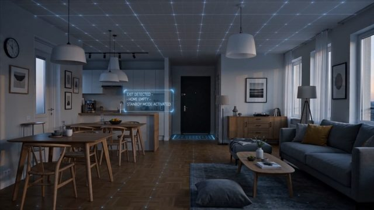<br><b>Energy</b><br><sub>Heat and light only the rooms that are actually in use.</sub></td>
    <td width="33%" valign="top">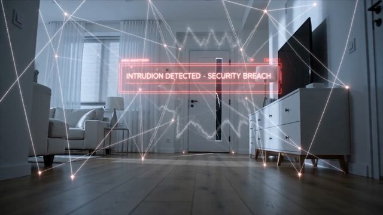<br><b>Privacy-first security</b><br><sub>Detect intrusion without recording anyone.</sub></td>
  </tr>
  <tr>
    <td valign="top">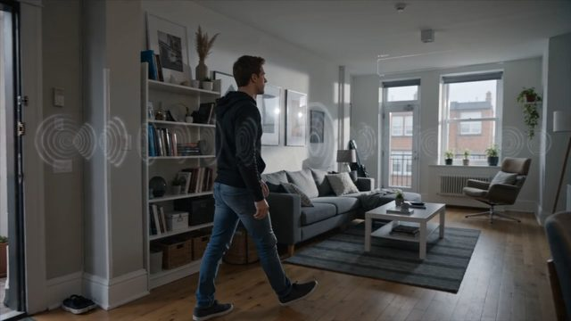<br><b>Smart spaces</b><br><sub>Lights and climate that follow people, not schedules.</sub></td>
    <td valign="top">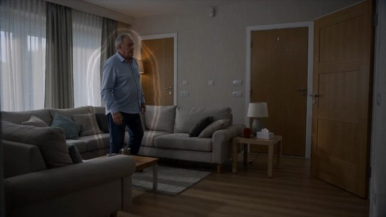<br><b>Daily rhythm</b><br><sub>Learn a home's normal routine and flag what breaks it.</sub></td>
    <td valign="top">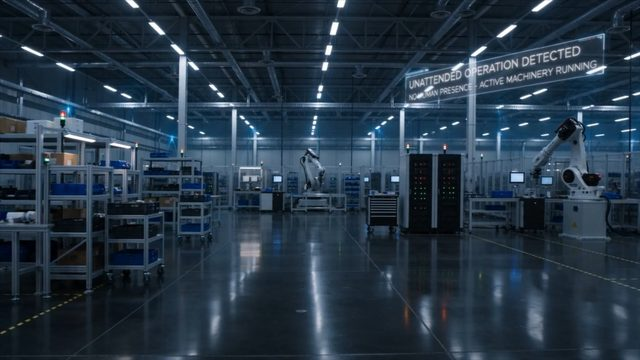<br><b>Industrial safety</b><br><sub>Know when a hazardous zone is occupied, or unattended.</sub></td>
  </tr>
</table>

<sub>Concept renders from our pitch video. They show where the architecture points, not features we have shipped.</sub>

**One model, many anomalies.** Every one of these is the same primitive:
*learn what normal looks like in this space, then notice when reality departs
from it.* A bathroom occupied for 45 minutes, an office busy at 3 a.m., a
tenant who has not moved between rooms all day. Adding a new application
means relabelling data, not rebuilding the stack. More in [the vision](docs/VISION.md).

##  Privacy by design

- **No images, no audio, no identities.** The only input is how a radio link
  behaves; there is nothing to recognise a face or a voice from.
- **Local by default.** Everything runs on the board or on your local
  network. There is no cloud component.
- **Minimal data.** The detector keeps a few seconds of numbers in memory to
  make a decision, not recordings.

##  Status

This is a hackathon project that grew. Here is what is real:

| Component | Status |
| --- | --- |
| RSSI detector on the Arduino UNO Q ([`rssi/rssi_demo.py`](rssi/rssi_demo.py)) | [OK] ran live on the UNO Q (May–June 2026) |
| UNO Q MCU bridge and relay control ([`firmware/uno-q-bridge`](firmware/uno-q-bridge), [`rssi/decision_engine.py`](rssi/decision_engine.py)) | [OK] tested on the UNO Q |
| Same detector on a Mac's Wi-Fi (`--source macos`) | [OK] verified September 2026 |
| Web demo ([`demo/`](demo)) | [OK] runs anywhere; simulated room, real detector |
| ESP32 cross-ping mesh ([`firmware/esp32-radar3d`](firmware/esp32-radar3d)) | [OK] used by the team; later robustness patches not re-verified on boards |
| CSI host: presence and 2D position ([`csi/`](csi)) | [OK] 123 unit tests · [OK] end to end with simulated frames · [OK] team hardware sessions |
| ML position regressor | [WARN] works, needs ~5 minutes of labelled data per room |
| Height class, breathing, heart rate, fall detection |  experimental, not validated, **not medical** |
| ESP-IDF single node ([`firmware/esp32-csi-node`](firmware/esp32-csi-node)) |  ported from RuView, not re-verified |
| Rust host ([`experimental/host-rust`](experimental/host-rust)) |  never compiled in this repo |
| CSI host running on the UNO Q |  next step |

##  Roadmap

- [ ] Run the CSI host on the UNO Q: the mesh and the board in one box
- [ ] Anomaly detection on long-term occupancy ("learn normal, flag the unusual")
- [ ] A labelled validation dataset, with ground truth that needs no camera (door and bed sensors)
- [ ] Home Assistant integration, end to end
- [ ] Counting more than one person

##  Repository layout

```
if-i-wi-fi/
├── demo/                 web demo: simulated room + the real RSSI detector (GitHub Pages)
├── rssi/                 Pipeline 1: RSSI detector, dashboard backend, UNO Q orchestration
├── csi/                  Pipeline 2: CSI host (presence, position, vitals, WebSocket)
├── firmware/
│   ├── uno-q-bridge/     STM32U585 sketch: relay, LED, sensors over RPC
│   ├── esp32-radar3d/    3-node cross-ping CSI firmware
│   └── esp32-csi-node/   ESP-IDF single-node CSI firmware
├── web/                  CSI 3D live monitor
├── tools/                CSI simulator, MAC discovery
├── tests/                123 pytest tests
├── experimental/         Rust host and unverified tools
├── docs/                 how it works, hardware, vision, journey, frame format
└── media/                images and their sources (media/src/)
```

##  Team

Built by three students at **Politecnico di Milano**:

| | |
| --- | --- |
| **Andrea Cacioppo** | [@nutriandrea](https://github.com/nutriandrea) |
| **Vincenzo Parente** | [@vincenzoparente04](https://github.com/vincenzoparente04) |
| **Pierluca Primiceri** | [@Pierluca-Primi](https://github.com/Pierluca-Primi) |

##  Acknowledgements

- **Arduino, NECSTLab and Politecnico di Milano**, for the hackathon and for
  putting an Arduino UNO Q in our hands.
- **[RuView](https://github.com/ruvnet/RuView)** by ruvnet (MIT / Apache-2.0):
  the ADR-018 frame format, several signal-processing and vitals modules, the
  ESP-IDF capture node and the Rust decoder are derived from it.
  [What we took and what we cut](docs/what-was-cut.md).
- **[ESP32-CSI-Tool](https://github.com/StevenMHernandez/ESP32-CSI-Tool)** by
  Steven M. Hernandez and **[Wifi-3D-Fusion](https://github.com/MaliosDark/wifi-3d-fusion)** by MaliosDark, which inspired the
  ESP32 firmware.
- **Espressif**, for exposing CSI on a chip that costs a few euros.

##  License

Dual-licensed under [MIT](LICENSE-MIT) or [Apache-2.0](LICENSE-APACHE), at
your option. See [LICENSE](LICENSE) for the parts derived from RuView.
