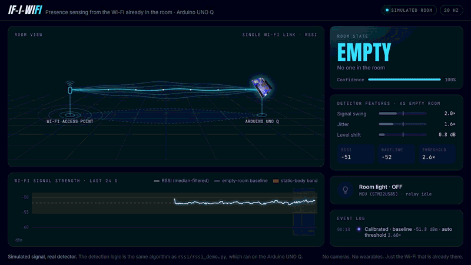

# Web demo

<p align="center"></p>

A single HTML file, no build step, no backend. It has two modes.

**Simulated (default).** A scripted person walks into a room, sits down and
leaves. A small physics-inspired model turns their position into an RSSI
stream: a body near the direct path lowers the level, motion near it makes
the signal fluctuate, breathing adds a ripple. The **real detector** then
classifies that stream. It is a line-by-line port of
[`rssi/rssi_demo.py`](../rssi/rssi_demo.py): median prefilter, empty-room
calibration, trimmed peak-to-peak, automatic threshold, hysteresis. Use
*Walk in*, *Sit down* and *Leave* to drive the person yourself.

**Live.** `python3 -m rssi.rssi_demo` serves this same page with live data
from a real Wi-Fi link (UNO Q, Linux or Mac):

```bash
python3 -m rssi.rssi_demo --source macos   # then open http://localhost:8080/
```

## Open it

- Online: GitHub Pages (see the link in the main README)
- Locally: `python3 -m http.server` from the repository root, then open
  <http://localhost:8000/demo/>. Opening the file directly also works.

## URL flags

| Flag | Effect |
| --- | --- |
| `?seed=7` | deterministic simulation |
| `?live` | read `/stream` from the Python backend (set automatically by `rssi_demo.py`) |
| `?capture` | hide controls and freeze the clock; `window.__advance(ms)` steps it (used to record `media/demo.gif`) |
