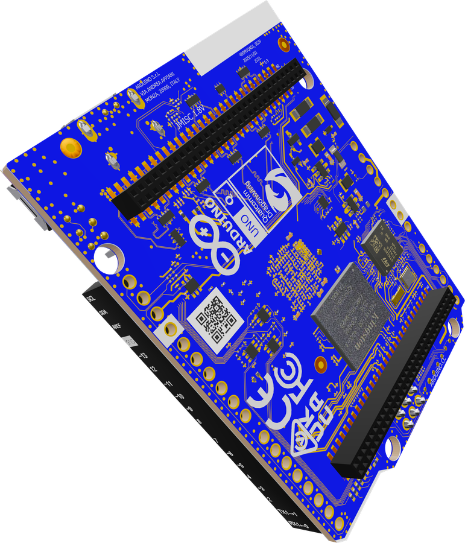

# Hardware

## Arduino UNO Q (Pipeline 1, and the target hub for Pipeline 2)

The UNO Q puts two computers on one UNO-sized board, which is exactly the
split a sensing product needs: heavy maths on one side, deterministic I/O on
the other.

| Component | Role in If-I-Wi-Fi |
| --- | --- |
| Qualcomm Dragonwing QRB2210 (4× Cortex-A53 @ 2 GHz, Debian Linux) | the Python pipeline: RSSI sampling, features, detection, dashboard |
| STM32U585 (Cortex-M33, Zephyr) | real-time I/O: relay, LED, sensors ([`firmware/uno-q-bridge`](../firmware/uno-q-bridge)) |
| Dual-band Wi-Fi 5 + Bluetooth 5.1 | the sensing substrate itself |
| 2–4 GB LPDDR4, 16–32 GB eMMC | enough to log and run scikit-learn models on the board |

**How the two brains talk.** Not through a classic `/dev/tty*`: the Linux side
runs the `arduino-router` service, which bridges the internal UART
(`/dev/ttyHS1`) to a MessagePack RPC socket at `/var/run/arduino-router.sock`.
Python calls `client.call("set_relay", 1)` and the STM32 answers. Our client is
[`rssi/bridge_client.py`](../rssi/bridge_client.py) (no dependencies, inline
MessagePack). The sketch needs the **Arduino_RouterBridge** library from the
Library Manager.

## ESP32 nodes (Pipeline 2)

| Board | Firmware | Status |
| --- | --- | --- |
| ESP32 (original, WROOM-32 / DevKit V1) | [`esp32-radar3d`](../firmware/esp32-radar3d) (Arduino) | used by the team, tested |
| ESP32-S3 dev board (8 MB) | [`esp32-csi-node`](../firmware/esp32-csi-node) (ESP-IDF) | ported from RuView, not re-verified here |
| ESP32-S3 SuperMini (4 MB) | `esp32-csi-node` | should work with a smaller factory partition |
| ESP32-S3 running `esp32-radar3d` | `esp32-radar3d` | untested |
| ESP32-C3 | none | not supported (single core, not enough RAM for Wi-Fi + CSI + lwIP) |

**Placement.** Three nodes in a triangle, about 1 m above the floor, 2–5 m
apart, with a clear view of the room.

**Power.** CSI at 100 Hz causes current spikes. If a node keeps rebooting,
fix the power instead of disabling the brownout detector: short USB cables,
a USB 3 port or a powered hub, or a dedicated 5 V supply.

## Host

| Host | Status |
| --- | --- |
| macOS (Apple Silicon), Python 3.10+ | used by the team |
| Linux x86_64 | works |
| Linux ARM64 (including the UNO Q's Debian) | the RSSI pipeline ran there; the CSI host is the next step |
| Windows | not tested by the team |

## Shopping list

| Item | For |
| --- | --- |
| Arduino UNO Q | Pipeline 1 |
| any 2.4 GHz access point, or a phone hotspot | Pipeline 1 (the link we sense) |
| 3× ESP32 dev boards + short USB cables | Pipeline 2 |
| a laptop | CSI host, development |
