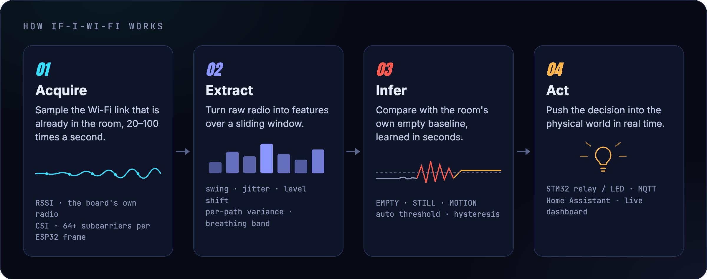

# How it works

<p align="center"></p>

## The physics in one minute

A Wi-Fi link at 2.4 GHz has a wavelength of about 12.5 cm. The signal that
reaches a receiver is the sum of the direct path and dozens of reflections off
walls, furniture and people (*multipath*). A human body is mostly water, so it
absorbs and scatters that energy. That has two effects we can measure:

| What the person does | What happens to the signal | Feature that catches it |
| --- | --- | --- |
| Moves anywhere near the link | the multipath pattern keeps changing, the signal fluctuates | variance, swing, jitter |
| Stands or sits *in* the path | part of the direct path is blocked, the average level drops | level shift vs. the empty room |
| Breathes while still | the chest moves a few mm, the phase oscillates at 0.1–0.5 Hz | band-passed phase (CSI only) |

Sensitivity is highest inside the *Fresnel zone*, the ellipse around the
straight line between transmitter and receiver. That is why the demo draws it
on the floor, and why node placement matters more than anything else.

## Two signals, two pipelines

| | **RSSI** (Pipeline 1) | **CSI** (Pipeline 2) |
| --- | --- | --- |
| What it is | one power reading (dBm) per frame | amplitude and phase for every OFDM subcarrier |
| Where it comes from | the UNO Q's own Wi-Fi radio | ESP32 nodes (the only cheap chip that exposes CSI) |
| Rate | ~20 Hz | 100 Hz per node |
| Resolution | 1 number | 64+ complex numbers per frame |
| Detects | presence, motion, a still body in the path | presence, motion, coarse position, breathing |
| Extra hardware | none | 1–3 ESP32 |
| Code | [`rssi/`](../rssi) | [`csi/`](../csi), [`firmware/esp32-radar3d`](../firmware/esp32-radar3d) |

## Pipeline 1: the RSSI detector

This is the detector behind the stage demo, in
[`rssi/rssi_demo.py`](../rssi/rssi_demo.py). The web demo runs the same
algorithm in JavaScript.

1. **Sample.** Read the RSSI of the board's own link from
   `/proc/net/wireless` (or `iw`, or CoreWLAN on a Mac) at 20 Hz. A tiny UDP
   "traffic generator" pings the gateway so the driver refreshes the value
   often.
2. **Clean.** A 5-sample median filter removes the single-sample spikes
   (6–11 dB) that Wi-Fi drivers produce.
3. **Calibrate.** Leave the room for a few seconds. The detector records
   15 s of empty channel and checks its quality: if the noise is above
   1.2 dB it assumes someone was still in the path and retries (up to 4
   times, keeping the cleanest run).
4. **Learn the baseline.** Over 50-sample windows of the empty room it
   computes:
   - **swing**: trimmed peak-to-peak (5th to 95th percentile), immune to outliers
   - **jitter**: standard deviation
   - **level**: median RSSI, with a band of `max(3.5, min(6σ, 7))` dB
5. **Pick a threshold automatically.** The threshold is 1.4 × the 95th
   percentile of the empty-room ratio, clamped to [2.6, 3.6]. A noisy room gets
   a higher threshold, a quiet room a more sensitive one, with no hand tuning.
6. **Decide, with hysteresis.** A sample is *hot* if
   `max(swing, jitter) / baseline > threshold` (movement) **or** the level
   leaves its band (a body blocking the path). Presence turns on when 70 % of
   the last 14 samples (~0.7 s) are hot and turns off below 25 %. The web demo
   labels presence as **MOTION** when variability drives it and **STILL**
   when only the level shift does.
7. **Act.** [`rssi/decision_engine.py`](../rssi/decision_engine.py) fuses the
   RSSI detector with optional monitor-mode capture and STM32 sensor readings,
   and drives a relay or LED on the microcontroller through the
   `arduino-router` RPC bridge ([`firmware/uno-q-bridge`](../firmware/uno-q-bridge)).

An optional RandomForest classifier ([`rssi/rssi_ml.py`](../rssi/rssi_ml.py))
can be trained on labelled windows when the statistical detector is not enough.

## Pipeline 2: the CSI mesh

### Capture: three ESP32 that ping each other

[`firmware/esp32-radar3d`](../firmware/esp32-radar3d) turns three ESP32 into a
small multistatic radar. Each node broadcasts a frame 100 times per second on
a fixed channel and records the CSI of the frames it hears from the others.
Three nodes give **six cross paths** (tx ≠ rx). Because the nodes use fixed,
known MAC addresses, the setup is immune to the MAC randomisation of phones.
Every frame is sent over UDP with magic `0xC5110003`
([frame format](csi-frame-format.md)).

### Processing on the host

[`csi/quadrants/ws_server.py`](../csi/quadrants/ws_server.py) is the main
entry point. It receives the frames and wires these stages together:

| Stage | Module | What it does |
| --- | --- | --- |
| Presence | `csi/presence/detector.py` | std of mean amplitude per path over ~1 s, max across paths, EMA; state machine **EMPTY / STILL / MOTION** with hysteresis and a minimum dwell time, calibrated on the empty room. No training. |
| Position, no ML | `csi/quadrants/blob_live.py` | per-receiver variance above baseline, weighted centroid of the receiver positions, spread as uncertainty |
| Position, ML | `csi/quadrants/regressor.py` | RandomForest regressor trained on labelled grid cells, 2D Kalman smoothing. A leave-one-cell-out gate rejects overfitted models and falls back to the centroid (`--quadrants-mode auto`). |
| Height class | `csi/blob3d/tracker.py` | LOW / MID / HIGH from the energy ratio of upper vs lower subcarriers (`--enable-3d`). Best effort. |

Results go out as WebSocket messages (`presence`, `position`, `cells`,
`position_ml`, `position_3d`, `diag`) to the [3D live monitor](../web).

Other building blocks live next to it and can be used from Python:

| Block | Module | Notes |
| --- | --- | --- |
| Vitals | `csi/vitals/`, `csi/breathing_ml.py` | breathing from phase band-passed at 0.1–0.5 Hz; heart-rate band 0.8–2.0 Hz, indicative only. Streamed by `csi.csi_mac --vitals`. |
| Signal toolbox | `csi/signal/` | Hampel filter, biquad filters, streaming Welford statistics, Fresnel helpers, spectrograms |
| Phase clean-up | `csi/phase_sanitizer.py` | unwrapping and outlier removal |
| Home Assistant | `csi/ha_bridge.py` | MQTT discovery and state publishing |
| Record / replay | `csi/csi_record.py` | save a capture, replay it at any speed |

You can run the whole chain without hardware:

```bash
./tools/simulate_csi.sh   # backend + 3 virtual ESP32 + browser UI
```

## Honest limits

- **One RSSI link cannot tell *where* someone is**, only that the link is disturbed.
- **Placement is everything.** A person far from every Fresnel zone is nearly invisible.
- **Several people, pets, fans and moving objects** all look like "motion".
- **Move the furniture, recalibrate.** The baseline belongs to one room layout.
- **Not a medical device.** Breathing and heart-rate estimates are experimental;
  fall detection is plausible but was never validated on real falls.

What we deliberately left out, and why, is in [what-was-cut.md](what-was-cut.md).
