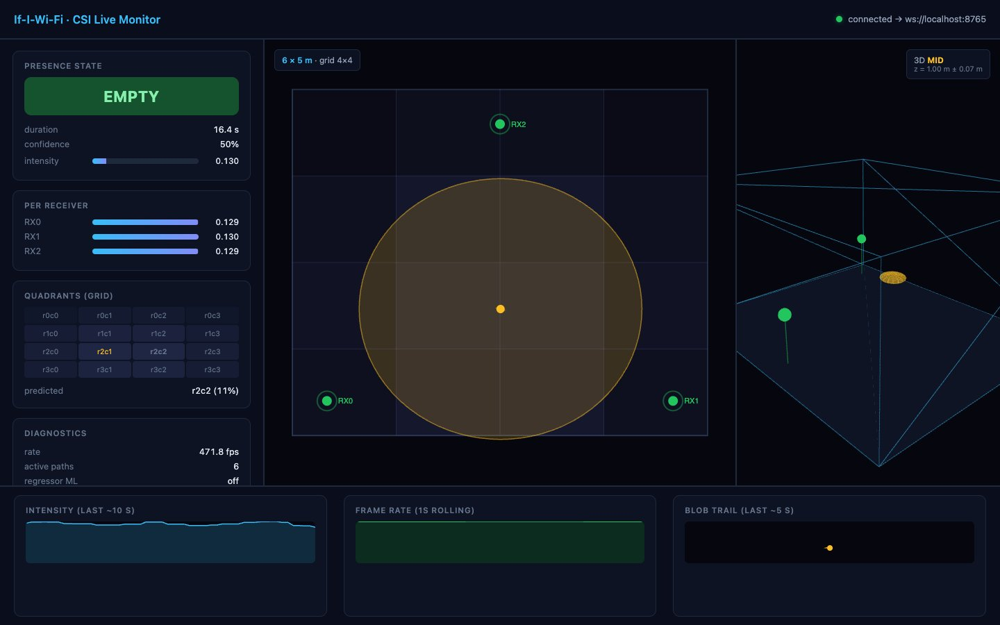

# CSI live monitor

<p align="center"></p>

A single-file web UI (HTML + vanilla JS + Three.js from a CDN) for Pipeline 2.
It connects to `csi.quadrants.ws_server` over WebSocket and shows:

- presence state, confidence and intensity
- per-receiver disturbance bars
- the grid heatmap with the predicted cell
- the 2D position with its uncertainty ellipse
- a 3D scene with the tracked blob (with `--enable-3d`)
- diagnostics: frame rate, active paths, calibration

## Run

```bash
# simplest: backend + three simulated ESP32 + this page
./tools/simulate_csi.sh

# with real hardware
python3 -m csi.quadrants.ws_server --udp-port 5005 --ws-port 8765 \
    --room 6x5 --grid 4x4 --rx "0.5,0.5;5.5,0.5;3.0,4.5" --enable-3d
open "web/ui.html?ws=ws://localhost:8765&room=6x5&grid=4x4"
```

URL parameters: `ws` (WebSocket URL), `room` (metres, `WxH`), `grid` (`RxC`), `3d=0` to hide the 3D view.

## WebSocket messages

| `type` | Payload |
| --- | --- |
| `hello` | `{version: 2}` on connect |
| `presence` | `state: EMPTY / STILL / MOTION`, confidence, intensity |
| `position` | `x, y, x_std, y_std` from the centroid estimator |
| `cells` | per-cell probabilities and the `predicted` cell |
| `position_ml` | the ML regressor's estimate |
| `position_3d` | `x, y, z, z_class` (with `--enable-3d`) |
| `diag` | rate in Hz, active paths, calibration progress |

The screenshot above was taken with simulated frames; the moving-person
simulation is simple, so the blob mostly sits near the centre.
